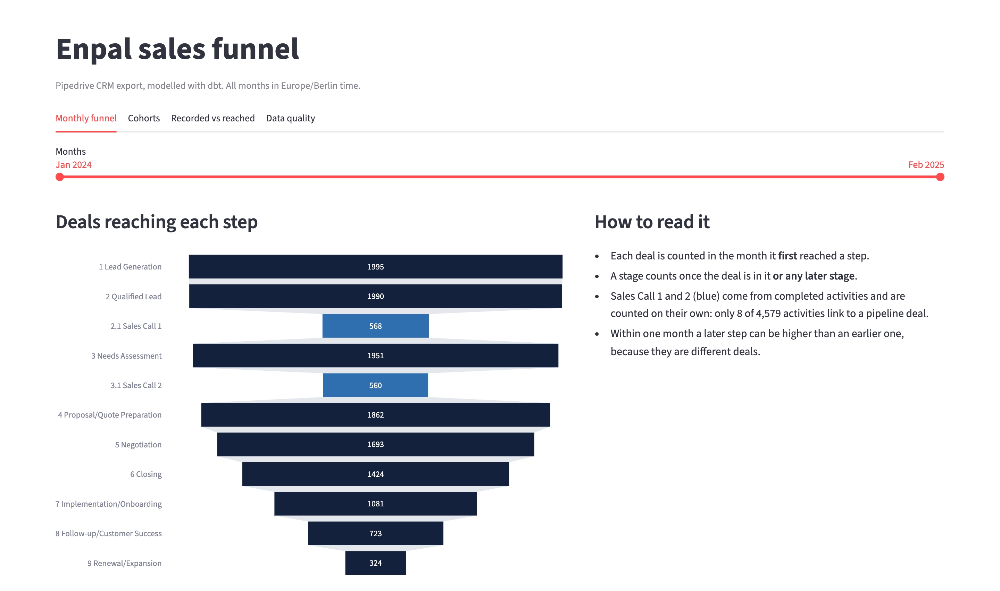
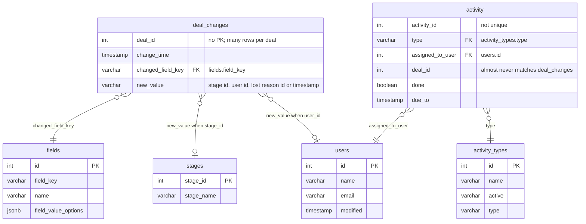
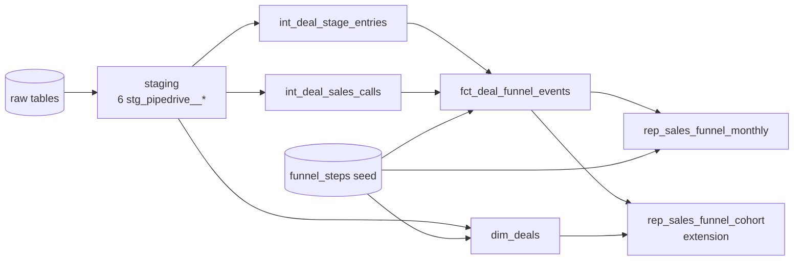

# Pipedrive Sales Funnel

This dbt project turns Enpal's Pipedrive CRM export into a monthly sales funnel report,
`rep_sales_funnel_monthly`. For every month and each of the 11 funnel steps, it shows how many deals
reached that step for the first time.

The raw data has no deals table, only a log of changes to deals, and it has a number of quirks. Most of the
work went into understanding the data and deciding what "a deal reached this step" should mean. Those
decisions are explained below, and the queries behind them are in `analyses/`.

The activity table surprised me. Only 8 of its 4,579 rows point to a deal that's actually in the
pipeline, so I couldn't connect the sales calls to their deals. The hardest decision was what to do with
skipped stages. I ended up counting them as reached, since a deal can't get to a signed contract without
a quote and an assessment first. I kept `is_recorded` in the fact table, though, in case someone wants
the stricter number.

## How to run it

You need Docker and Python 3.

```bash
make setup      # create .venv, install dbt (and the dashboard packages)
make up         # start Postgres and load the raw CSVs
make build      # build the seed and models and run all tests
make brief      # optional: build only what the assignment asks for, without the extra cohort report
make docs       # optional: open the dbt docs (every model and column, lineage graph)
make dashboard  # optional: open the Streamlit dashboard at http://localhost:8501
```

If `make` isn't installed, run the same steps directly:

```bash
docker compose up -d && docker compose wait data_loader
python3 -m venv .venv && source .venv/bin/activate
pip install -r requirements.txt
dbt build
```

The database runs on `localhost:5432` (user `admin`, password `admin`, database `postgres`). All models are
built in the schema `public_pipedrive_analytics`.

The provided loader (`raw_data/load_data.sh`) appends the CSVs, so running it twice doubles `activity`
and `deal_changes` and breaks the uniqueness tests. `make up` checks first: if the tables already have
data, it stops with a message and changes nothing. `make up REFRESH=1` empties them and loads the CSVs
again.

## Where to look

- Data exploration: [`analyses/`](analyses), five SQL files that each start with what I found and what I
  decided because of it. Summary under [What I found in the data](#what-i-found-in-the-data).
- Data model: [`models/`](models), with the funnel definition in
  [`seeds/funnel_steps.csv`](seeds/funnel_steps.csv). Explained under [Decisions](#decisions) and
  [Data model](#data-model).
- SQL choices: [SQL efficiency](#sql-efficiency).
- Documentation: every model and column has a description; `make docs` opens them with the lineage graph.

## How the funnel is counted

`deals_count` is the number of different deals that reached a step for the first time in that month.
Months are calendar months in German time (Europe/Berlin).

| Step | KPI | Where it comes from | What it means at Enpal |
|---|---|---|---|
| 1 | Lead Generation | pipeline stage 1 | A homeowner asks for a quote |
| 2 | Qualified Lead | pipeline stage 2 | Qualification call: a system is possible on this house |
| 2.1 | Sales Call 1 | completed `meeting` activity | First consultation, usually by video |
| 3 | Needs Assessment | pipeline stage 3 | Roof, building or existing system assessed |
| 3.1 | Sales Call 2 | completed `sc_2` activity | Offer presentation |
| 4 | Proposal/Quote Preparation | pipeline stage 4 | Quote for rental or purchase |
| 5 | Negotiation | pipeline stage 5 | Configuration, price and financing agreed |
| 6 | Closing | pipeline stage 6 | Contract signed |
| 7 | Implementation/Onboarding | pipeline stage 7 | Site check, installation, grid registration |
| 8 | Follow-up/Customer Success | pipeline stage 8 | System is live: monitoring and service |
| 9 | Renewal/Expansion | pipeline stage 9 | Upsell (battery, wallbox, heat pump, Enpal.One+) or tariff renewal |

A pipeline step counts a deal in the month it first got to that stage or any later stage. Sales reps
often skip stages in the CRM, for example moving a deal straight from Qualified Lead to Closing. A signed
contract still means there was a quote and an assessment, so the deal is counted for the steps in
between too. If a deal enters the same stage twice, it is counted once. A sales call step counts a deal
in the month of its first completed call of that type.

The report answers "how much progress happened in March?". Over all months each pipeline stage has fewer
deals than the one before. Within one month a later step can be bigger, because the deals reaching it that
month are different deals. To follow one group of deals through the funnel, see the
[cohort report](#extras).

I assume stage ids are in pipeline order (1 is the first stage, 9 the last). This export has no stage
order field; with the live API I would use the stage's `order_nr`, which
[Pipedrive uses to define the order of stages in a pipeline](https://developers.pipedrive.com/docs/api/v1/Stages).
The data has no won/lost status, so the funnel can only show how far deals got.

The step list, names and order are in [`seeds/funnel_steps.csv`](seeds/funnel_steps.csv). To rename a
KPI, add a step or point a step at a different stage, you edit that file and don't touch the SQL.

## The result

`rep_sales_funnel_monthly` has the four columns the assignment asks for (`month`, `kpi_name`,
`funnel_step`, `deals_count`) and 154 rows: 14 months (January 2024 to February 2025) × 11 steps.

Each row covers a whole calendar month. The `month` column stores it as a date, using
its first day, so `2024-05-01` means all of May 2024, not 1 May. A deal that reached Closing on 17 May is
counted in the `2024-05-01` row. I used a date instead of text like `05-2024` because a date sorts,
filters and joins correctly. How the month is displayed is up to the dashboard.

Here is every month side by side. The columns are the step numbers from
[How the funnel is counted](#how-the-funnel-is-counted), and the last row is the total per step:

| Month | 1 | 2 | 2.1 | 3 | 3.1 | 4 | 5 | 6 | 7 | 8 | 9 |
|---|---:|---:|---:|---:|---:|---:|---:|---:|---:|---:|---:|
| 2024-01 | 30 | 6 | 77 | 1 | 67 | 1 | 0 | 0 | 0 | 0 | 0 |
| 2024-02 | 191 | 92 | 64 | 49 | 59 | 31 | 20 | 11 | 3 | 2 | 2 |
| 2024-03 | 202 | 232 | 54 | 197 | 75 | 133 | 88 | 55 | 36 | 19 | 7 |
| 2024-04 | 230 | 208 | 71 | 197 | 58 | 185 | 163 | 128 | 83 | 52 | 23 |
| 2024-05 | 246 | 237 | 61 | 226 | 65 | 212 | 184 | 153 | 108 | 78 | 25 |
| 2024-06 | 246 | 246 | 64 | 246 | 66 | 240 | 207 | 179 | 136 | 98 | 42 |
| 2024-07 | 265 | 254 | 88 | 241 | 65 | 222 | 214 | 194 | 154 | 84 | 48 |
| 2024-08 | 239 | 255 | 57 | 256 | 72 | 244 | 211 | 179 | 136 | 107 | 37 |
| 2024-09 | 208 | 222 | 32 | 210 | 33 | 223 | 224 | 158 | 125 | 78 | 43 |
| 2024-10 | 120 | 173 | 0 | 207 | 0 | 208 | 187 | 167 | 129 | 78 | 36 |
| 2024-11 | 18 | 61 | 0 | 101 | 0 | 117 | 124 | 115 | 97 | 74 | 31 |
| 2024-12 | 0 | 4 | 0 | 18 | 0 | 41 | 58 | 63 | 54 | 34 | 19 |
| 2025-01 | 0 | 0 | 0 | 2 | 0 | 5 | 13 | 19 | 17 | 16 | 10 |
| 2025-02 | 0 | 0 | 0 | 0 | 0 | 0 | 0 | 3 | 3 | 3 | 1 |
| **Total** | **1,995** | **1,990** | **568** | **1,951** | **560** | **1,862** | **1,693** | **1,424** | **1,081** | **723** | **324** |

The same totals as a funnel, from the [dashboard](#extras):



How to read it:

- No new deals are created after September 2024, and a deal reaches stage 1 about 35 days after it is
  created. That is why the early steps fade out over October and November, while deals already in the
  pipeline keep moving through the later steps until February 2025.
- The sales call steps stop in September because the activity data ends there.
- In January 2024, Sales Call 1 (77) is higher than Lead Generation (30). That is expected in a per-month
  view: those calls belong to different deals than the 30 new leads.

`analyses/05_output_validation.sql` recounts every total straight from the raw tables, and all 11 match.

## Decisions

The assignment leaves these questions open, and each answer changes the numbers.

| # | What I decided | Alternative option | Why | Effect on the report |
|---|---|---|---|---|
| 1 | A skipped stage counts as reached once the deal is in a later stage | Count only stages the deal was actually logged in | 84% of deals skip at least one stage in the CRM, but a signed contract implies the earlier steps happened | Closing has 1,424 deals instead of 741 |
| 2 | Each step counts once per deal, in the month it was first reached | Count every entry, or date everything by the deal's creation month | Counting every entry would double count deals that go back and forth. Creation month is a different question (the cohort report answers it) | No double counting |
| 3 | Step 1 is the day the deal enters stage 1 | Use the creation date | Then every step is measured the same way. Stage 1 comes about 35 days after creation | 1,732 of 1,995 deals land in a different month than their creation month |
| 4 | Sales calls are counted from completed activities, even if the deal isn't in the pipeline data | Only count calls that match a pipeline deal | Only 8 of 4,579 activities match a pipeline deal. Requiring a match would leave these steps almost empty | 568 and 560 deals instead of 1 and 1. A test warns about the gap so it stays visible |
| 5 | Sales Call 1 and Sales Call 2 are counted independently | Require Sales Call 1 before Sales Call 2 | No deal with a Sales Call 2 has a Sales Call 1 | Steps 2.1 and 3.1 don't depend on each other |
| 6 | Months follow German time | Keep the raw UTC timestamps | Pipedrive stores UTC, and a German business closes its months in German time | 25 stage changes move to a different month |
| 7 | Lost deals stay in the funnel | Remove deals with a lost reason | Every deal ends with a lost reason, even the 324 that reached Renewal/Expansion. For those, it reads like a later cancellation or a lost upsell | The funnel shows how far deals got. `dim_deals` records the stage at which each deal was lost |
| 8 | The funnel definition lives in a seed file | Hard-code it in SQL | Step names differ between source tables, and the business can change the funnel without a SQL change | Renaming or remapping a step means editing one CSV |
| 9 | Odd data is flagged and left as it is | Clean or guess missing values | Fixing it would mean inventing facts | Problems are flagged in columns and covered by tests |

## What I found in the data

The queries are in `analyses/` (`dbt compile -s path:analyses` turns them into plain SQL):

| File | What it checks |
|---|---|
| [`01_source_profiling`](analyses/01_source_profiling.sql) | Row counts, keys, nulls, duplicates |
| [`02_deal_lifecycle`](analyses/02_deal_lifecycle.sql) | Event order, stage moves and skips, shared deal ids, lost reasons |
| [`03_activities`](analyses/03_activities.sql) | Activity types, unmatched deal ids, reused ids, call order |
| [`04_plausibility_and_timing`](analyses/04_plausibility_and_timing.sql) | Signs of generated data, time zone, installation lag |
| [`05_output_validation`](analyses/05_output_validation.sql) | Report totals against an independent count from the raw tables |

### The source tables

There are six raw tables. There is no deals table: a deal only exists as a series of changes in
`deal_changes`. Its creation date, owner, stage and lost reason all have to be rebuilt from that log.



| Table | Rows | One row is |
|---|---:|---|
| `deal_changes` | 15,406 | One change to one field of a deal (created, owner, stage or lost reason). 1,995 deals, Jan 2024 to Mar 2025 (stage changes end in February 2025; March has only lost reasons) |
| `activity` | 4,579 | One activity (a call) for a deal, Jan to Sep 2024 |
| `users` | 1,787 | A CRM user |
| `stages`, `fields`, `activity_types` | 9, 4, 4 | Lookup tables |

### Business context

Enpal sells home energy systems in Germany (solar, battery, heat pump, wallbox, Enpal.One+), mostly
remotely, from quote request to contract, then installation, service and upselling. I used this to
choose the definitions in the funnel table above. The data itself looks generated (a flat 205 to 262
new deals per month, 1,787 users for 1,995 deals, lost reasons spread evenly), so I left it as it is.

### Data quality issues

Three of these shape the report the most: almost no activities link to a pipeline deal (DQ-2), most
deals skip stages in the CRM (DQ-4), and every deal ends with a lost reason (DQ-5). The rest are smaller,
and the table says how each one is handled.

Every number here comes from the queries in `analyses/`. The IDs (DQ-1 and so on) are also used in those
files and in the model comments.

| ID | What I found | How I handled it |
|---|---|---|
| DQ-1 | 5 deal ids were created twice. Every other deal has all its events at one time of day; these have two times of day, so two different deals share each id. They also hold all 8 backward stage moves. | Each step is counted once per id. Flagged in `dim_deals.has_multiple_creation_events` |
| DQ-2 | Only 8 of 4,579 activities point to a deal that exists in `deal_changes`. | Sales calls are counted on their own. A test warns, instead of failing, that 1,126 of the 1,128 deal and call-type rows have no pipeline deal |
| DQ-3 | `activity_id` is not unique: 11 ids are reused by unrelated activities. | Built a new unique key, `activity_key`, and tested it |
| DQ-4 | 36% of stage moves skip at least one stage; 84% of deals skip at least once. | A stage counts as reached once the deal is in a later stage. `is_recorded` shows whether it was actually logged |
| DQ-5 | Every deal ends with a lost reason, including the 324 that reached Renewal/Expansion. | Lost deals stay in the funnel. `dim_deals` records the stage and sales phase where each deal was lost |
| DQ-6 | New deals stop in September 2024, but stage changes go on until February 2025. | Expected: deals keep moving after creation (median 15 days from Closing to Implementation). Months with no activity still get rows with 0 |
| DQ-7 | None of the 560 deals with a completed Sales Call 2 has a completed Sales Call 1. | The two call steps are counted independently |
| DQ-8 | Stage 2 is "Qualified lead" in `stages` but "Qualified Lead" in `fields` and the assignment. | KPI names come from the seed file, so they always match the assignment |
| DQ-9 | The `follow_up` activity type is marked inactive but is used by 1,133 activities. | Not a funnel step; the active flag is kept as a column |
| DQ-10 | `new_value` holds a stage id, a user id or a timestamp, depending on which field changed. | Values are converted only after filtering by field. A test fails the build if a new field type appears |
| DQ-11 | `deal_changes` and `activity` have no primary key. | Uniqueness is tested on the keys I built instead |
| DQ-12 | `users` has 4 duplicate emails and 21 duplicate names. | Users are joined on id only |
| DQ-13 | Timestamps have no time zone. | Treated as UTC, since [Pipedrive's API returns all times in UTC](https://pipedrive.readme.io/docs/core-api-concepts-date-format), and converted to German time. This moves 25 stage changes into a different month |
| DQ-14 | A deal's first stage change comes a median 35 days after it was created. | Step 1 uses the stage 1 date like every other step. The creation month is only used for cohorts |
| DQ-15 | `due_to` is a due date; there is no completion time. | Used as the date of a completed call |

For a live setup: Pipedrive's deal history only lists updates to field values (see the
[changelog endpoint](https://developers.pipedrive.com/docs/api/v1/Deals)), so a deal that never moves has no stage event. A
production model should fall back to the deal's current stage from the API, and use the activity's real
completion time instead of `due_to`.

## Data model



The data flows through four layers:

| Layer | Built as | Models | What happens here |
|---|---|---|---|
| Staging | view | [`stg_pipedrive__*`](models/staging/pipedrive) | One model per raw table: clean names, correct types, convert UTC to German time. No business logic |
| Intermediate | view | [`int_deal_stage_entries`](models/intermediate/int_deal_stage_entries.sql), [`int_deal_sales_calls`](models/intermediate/int_deal_sales_calls.sql) | Find the first time each deal reached each stage or sales call |
| Marts | table | [`dim_deals`](models/marts/dim_deals.sql), [`fct_deal_funnel_events`](models/marts/fct_deal_funnel_events.sql) | `dim_deals`: one row per deal with its current state. `fct_deal_funnel_events`: one row per deal and funnel step |
| Reporting | table | [`rep_sales_funnel_monthly`](models/reporting/rep_sales_funnel_monthly.sql), [`extensions/rep_sales_funnel_cohort`](models/reporting/extensions/rep_sales_funnel_cohort.sql) | Tables shaped for a dashboard |

A few setup choices:

- Materialization and tags are set per folder in `dbt_project.yml`, so the models don't need their own
  config blocks. Models in `reporting/extensions/` are tagged `extension`, so they can be left out of a run.
- `rep_sales_funnel_monthly` has an enforced contract: the column names and types are fixed. The
  assignment defines these columns and a dashboard depends on them, so any change fails the build.
- There are two small macros and no external packages. `to_reporting_timezone` converts timestamps to
  German time, with the time zones set as variables in `dbt_project.yml`. `surrogate_key` builds a hashed
  key from several columns and handles NULLs safely.
- There are no incremental models. The data is about 15k rows and is reloaded from CSV on every start, and an
  activity can change later (a call gets marked done). A full rebuild is fast and always correct. At
  production scale I would make `fct_deal_funnel_events` incremental: rebuild only the deals that have
  new events, plus a short lookback window.

## SQL efficiency

- `dim_deals` builds every deal attribute in one pass over the event log, in a single `group by`. The
  latest owner or stage is the first value of an ordered `array_agg`, so there is no subquery,
  self-join or window per attribute.
- The intermediate models shrink the events to one row per deal and step before any join, so the report
  is a simple count over a 14k-row table. The "stage or any later stage" rule needs only one grouping
  and one join: it spreads each recorded stage over the earlier ones and takes the earliest time.
- Stage events and sales call events never overlap, so they are combined with `union all`, which skips
  the duplicate-removing sort that `union` does.
- `new_value` is cast to a number only on rows where the field type guarantees a number.
- Staging and intermediate models are views, which cost nothing to store and are always fresh. Marts and
  reports are tables, because dashboards query them.
- Models have no `order by`. Sorting a stored table costs time and doesn't fix the order anyone reads
  it in later.
- The monthly report takes its first and last month from the counts it has already grouped, so it reads
  the fact table once, not twice.
- Tests use `count(*)` instead of `count(distinct deal_id)`: the fact table has one row per deal and
  step (a test enforces it), so de-duplicating again would be wasted work.
- The cohort report finds each deal's previous stage with `lag()`, so no table is joined to itself.
- Every model has the same layout: the inputs first, then the logic steps, then one final `select`.

None of these changes the output. Before the last round of changes I saved an md5 checksum of every row
of both reports, the fact table and `dim_deals`; afterwards all four were identical and every test
passed. At 15k rows the time saved is milliseconds (the `dim_deals` query went from 17 to 12 ms); the
point is the patterns, which matter on large data.

## Tests

`make build` runs 65 tests alongside the models. All pass except one warning that is there on purpose:
the sales call deals that can't be found in the pipeline (DQ-2).

- The YAML files hold the usual checks: unique and not-null keys, relationships between models, and
  allowed values.
- The report has an enforced contract, so its column names and types can't change by accident.
- Four custom tests in [`tests/`](tests) check the report itself:
  - one row per month and step;
  - totals that match the fact table;
  - no stage with more deals than the stage before it;
  - a cohort report that adds up.

## Recommendations

The data looks generated, so these are things I would check in real data, not conclusions.

- Sales leadership: the front of the funnel works, with 67 to 77% of each month's new deals reaching
  Closing. The weak points are later. In every cohort only 36 to 55% of deals move from Follow-up to
  Renewal/Expansion, the upsell after installation, and 1,079 of the 1,995 deals were lost after
  signing. Both are worth more attention than lead volume.
- Sales operations (CRM owners): only 8 of 4,579 activities are linked to a deal, and 84% of deals skip
  stages. Making the deal field required on activities, moving deals one stage at a time, and recording
  whether a deal was won (today every deal only gets a lost reason) would make the funnel measurable
  without the assumptions in [Decisions](#decisions).
- Data team, before this runs on live data: load the deals themselves as well as their change history,
  so a deal that never changed stage still appears; make `fct_deal_funnel_events` incremental; and have
  dashboards sort by `step_order`, since `funnel_step` is text.
- Questions for the sales team: does a lost reason after signing mean a cancellation? Do stage ids follow
  the real order of the sales process? And are sales calls logged against the deal they belong to? Today
  almost none are (DQ-2) and no deal has both calls (DQ-7), so steps 2.1 and 3.1 can't yet be read as part
  of the same funnel as the stages.

## Extras

- A cohort report, [`rep_sales_funnel_cohort`](models/reporting/extensions/rep_sales_funnel_cohort.sql)
  in `models/reporting/extensions/`. It groups deals by the month they were created and shows, per stage,
  how many reached it, the share of the group and of the previous stage, and the median days from the
  previous stage. It answers the question the monthly report can't: *of the deals created in March, how
  many got to each stage, and how fast?* For example, of the 243 deals created in March 2024, 77% reached
  Closing (a median of 17 days after Negotiation) and 18% reached Renewal/Expansion. In every month the
  weakest step is from Follow-up to Renewal (36 to 55% move on), which is the upsell after installation.
  It covers pipeline stages only, since sales calls can't be linked to deals (DQ-2).
- A Streamlit dashboard, [`dashboard/app.py`](dashboard/app.py). After `make build`, `make dashboard`
  starts it at [http://localhost:8501](http://localhost:8501). Four tabs, read live from the models: the
  monthly funnel with a month filter (shown under [The result](#the-result)), the cohorts, recorded vs
  reached stages (decision 1 in numbers) and the main data quality findings.
- Next steps I would take: a cancellation rate after signing from `dim_deals.lost_phase`, rep-level
  analysis once activities link to deals, and incremental loading with freshness checks once the source
  is a live connector.
